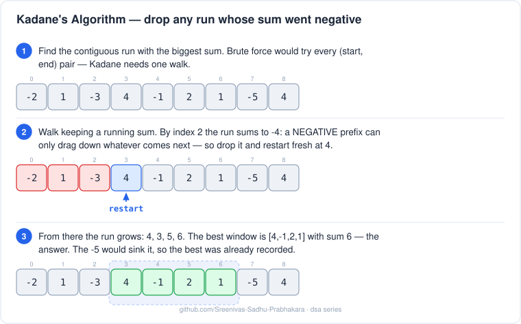

# Kadane's Algorithm (Maximum Subarray Sum)

> Striver SDE Sheet 004 · Day 1 Arrays — one pass, dropping any running prefix whose sum has gone negative. Go, stdlib only, tested.

## Problem

Given an integer array, find the contiguous non-empty subarray with the largest sum and return that sum. The array may be entirely negative — the answer is then the single largest element, not an empty subarray.

## Approach

Walk once, keeping the best sum of a subarray *ending here*. The key observation: a negative running prefix can never help whatever comes next, so the moment the running sum dips below zero, discard it and restart at the current element. Track the global best along the way. Initializing both to the first element (not zero) is what makes all-negative inputs come out right.

**Complexity:** O(n) time, O(1) space.

## Visual walkthrough

Read the picture top to bottom — each numbered frame is one moment of the algorithm
running on this repo's test example.

## Run

    go test ./...   # verify
    go run .        # demo

---

One of 191 repos solving Striver's SDE Sheet in Go — stdlib only, one problem per repo, every solution tested. Browse the set: [`dsa-*` repos](https://github.com/Sreenivas-Sadhu-Prabhakara?tab=repositories&q=dsa-&type=source).
